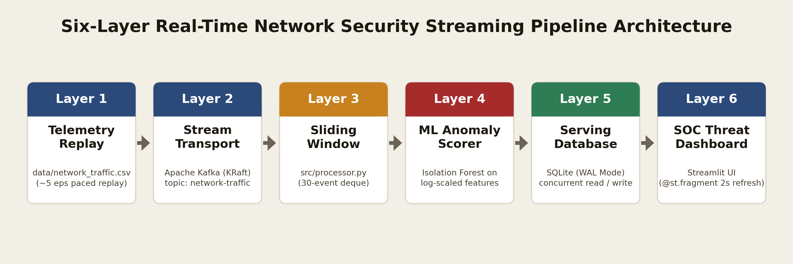
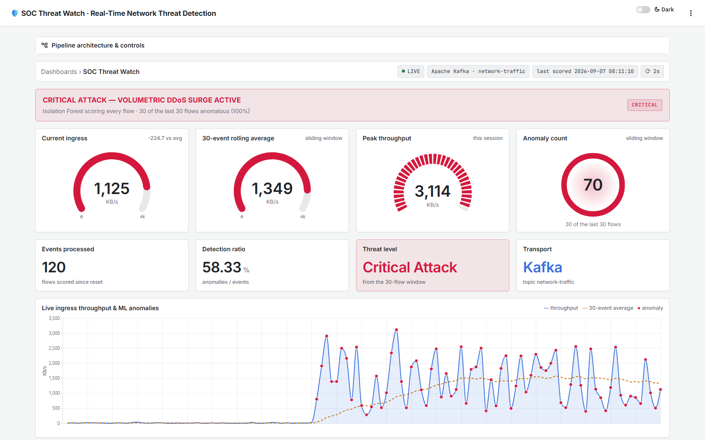
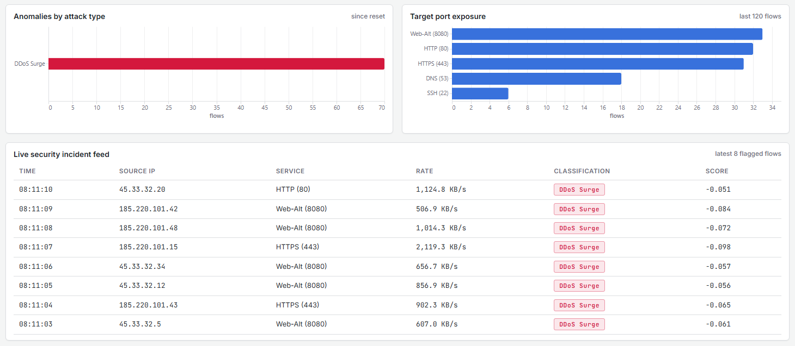

# Real-Time Network Intrusion & DDoS Detection

### A six-layer streaming analytics pipeline — Kafka · Python · Isolation Forest · SQLite · Streamlit

This project watches network traffic **as it happens** and raises an alarm the moment an attack
starts. Network-flow records are streamed through **Apache Kafka**, a stream processor keeps live
statistics over a sliding window, an **Isolation Forest** machine-learning model scores every flow,
results are stored in **SQLite**, and a **Streamlit** dashboard refreshes itself every 2 seconds —
like a small Security Operations Center (SOC).



---

## Contents
1. [What it does](#what-it-does)
2. [How it works — the six layers](#how-it-works--the-six-layers)
3. [Dataset](#dataset)
4. [Machine-learning model](#machine-learning-model)
5. [Live dashboard](#live-dashboard)
6. [How to run it](#how-to-run-it)
7. [Testing](#testing)
8. [Results](#results)
9. [Conclusion and limitations](#conclusion-and-limitations)
10. [Project structure](#project-structure)

---

## What it does

* Replays 8,000 network flows (one per second) as a **live event stream**.
* Detects three kinds of attack in real time: **volumetric DDoS**, **SYN floods** and **port scans**.
* Shows the current, rolling-average and peak throughput, the number of anomalies, a live chart with
  red markers on every suspicious flow, and an incident feed naming the attacker IPs.
* Escalates a threat banner from **NORMAL** → **SUSPICIOUS** → **CRITICAL ATTACK** as anomalies pile up.
* Runs with one click on Windows (`run.bat`) or with one command on any machine with Docker.

## How it works — the six layers

The course guide requires six layers, with a streaming tool, an ML algorithm and a visualization
tool as mandatory parts. Each layer is a separate piece of code, so they work independently:

| # | Layer | What it does | File | Tool |
|---|---|---|---|---|
| 1 | **Data source** | Reads the dataset row by row and publishes one JSON event every 0.2 s (5 events/s), turning a static file into a live stream | `src/producer.py` | CSV replay |
| 2 | **Streaming tool** *(mandatory)* | Carries events from producer to processor through the topic `network-traffic` | `src/stream_broker.py` | **Apache Kafka 4.1** (KRaft) |
| 3 | **Stream processor** | Keeps the last 30 flows in memory (`deque(maxlen=30)`), computing the rolling average, running peak and the number of anomalies in the window | `src/processor.py` | Python |
| 4 | **ML algorithm** *(mandatory)* | Scores every flow with a model trained offline; labels flagged flows as DDoS / SYN flood / port scan from their features | `src/processor.py`, `models/train_model.py` | **Isolation Forest** (scikit-learn) |
| 5 | **Database** | Stores every scored flow plus a one-row live KPI snapshot; WAL mode lets the dashboard read while the processor writes | `src/database.py` | SQLite (WAL) |
| 6 | **Visualization** *(mandatory)* | Re-queries the database every 2 s and redraws the live part of the page | `dashboard/app.py` | **Streamlit** + Altair |

**Why the layers are decoupled:** the producer never waits for the processor, and the processor never
waits for the dashboard. Kafka buffers bursts, and the database sits between processing and display,
exactly as the course guide recommends.

**Kafka and the fallback:** when Docker Desktop is running, `run.bat` starts a Kafka broker
(`docker compose up -d kafka`) and the pipeline streams through it; the dashboard shows
*Transport: Apache Kafka*. If no broker is available, the project still runs on a small local
channel with the same "read only new messages" behaviour, and the dashboard says so.

## Dataset

`data/network_traffic.csv` is generated by `data/generate_dataset.py` (fixed random seed, so it is
always the same): **8,000 flows**, one per second. Normal web, DNS, SSH and API traffic is mixed with
seven attack bursts:

| Class | Flows | What it looks like |
|---|---|---|
| Normal | 7,213 | 1–80 packets, 64 B – 49 KB, 0.01–12 s |
| DDoS (volumetric) | 403 | 404–2,200 packets, up to 3.2 MB per flow |
| SYN flood | 162 | 151–794 small packets, 85–100 % SYN |
| Port scan | 222 | 1–4 tiny packets to random ports, 100 % SYN |

Each flow has four model features: `packet_count`, `byte_count`, `duration_sec` and `syn_ratio`.
The ground-truth label is used **only to evaluate** the model, never to train it or drive the
dashboard.

## Machine-learning model

* **Algorithm:** Isolation Forest (unsupervised). It isolates unusual points with random splits;
  points that are isolated quickly are anomalies.
* **Train once, score live:** the model is trained offline on the first 70 % of the flows and saved to
  `models/anomaly_model.pkl`. The stream never retrains; the processor scores each batch of new
  events in one call (~5 µs per flow).
* **Key decision — log scaling:** the raw byte counts range from 40 bytes to 3.2 MB, so on raw values
  the model **missed every port scan (0 / 222)**. Passing all features through `log1p` fixed this:
  **787 / 787 attack flows detected**.
* **Contamination = 0.10**, matching the real attack share (9.8 %). Comparison on all 8,000 flows:

| Contamination | Precision | Recall | F1 | False alarms |
|---|---|---|---|---|
| 0.05 | 1.00 | 0.51 | 0.68 | 0.0 % |
| 0.08 | 1.00 | 0.83 | 0.91 | 0.0 % |
| **0.10 (used)** | **0.95** | **1.00** | **0.97** | **0.57 %** |
| 0.12 | 0.78 | 1.00 | 0.88 | 3.1 % |
| 0.15 | 0.63 | 1.00 | 0.77 | 6.3 % |

* **Attack labels:** Isolation Forest only says *"unusual"*. Flagged flows are then labelled from their
  own features — very high volume → DDoS, many SYN packets → SYN flood, a few SYN-only packets →
  port scan; anything else is shown as "Unclassified Anomaly".

Retrain and print this table: `py -3.10 run.py train` and `py -3.10 models/train_model.py --sweep`.

## Live dashboard





* **Status strip** — live/standby, the transport in use (Apache Kafka), the last scored flow.
* **Threat banner** — NORMAL, SUSPICIOUS or CRITICAL ATTACK, naming the attack type.
* **Gauges** — current ingress, 30-event rolling average, session peak (segmented gauge), and an
  anomaly ring showing how much of the sliding window is anomalous.
* **Stat panels** — events processed, detection ratio, threat level, transport.
* **Live chart** — throughput (blue), 30-event average (amber dashed), red dot on every anomaly.
* **Breakdowns** — anomalies per attack type and flows per destination port.
* **Incident feed** — the latest flagged flows with source IP, service, rate, class and score.
* **Light / Dark switch** in the header; the **⋮ menu** offers Print (save as PDF), Clear cache and About.
* **Pipeline architecture & controls** drawer — the six layers and a *Reset stream & database* button.

## How to run it

### Option A — Docker (any computer, nothing else to install)
```bash
docker compose up --build      # Kafka + the whole pipeline -> open http://localhost:8501
docker compose down            # stop
```
The image installs the pinned packages, trains the model inside the container and starts the
producer, processor and dashboard. The stream starts by itself; the first attack appears after ~10 s.

### Option B — Windows with `run.bat`
```bash
py -3.10 -m pip install -r requirements.txt    # once
```
Start **Docker Desktop** (for Kafka), then double-click **`run.bat`**:

| Option | What it does |
|---|---|
| 1 | **Live demo** — dashboard opens, first DDoS attack after ~10 s |
| 2 | Full replay of the dataset from the first flow |
| 3 | Automated end-to-end test |

While streaming: **P** = pause / resume, **Q** = stop.

**Freeze test (from the course guide):** during the demo press **P**. The page keeps refreshing every
2 s but every number stays frozen — proof that "live" depends on data moving, not on a timer.
Press **P** again and the stream continues.

## Testing

`run.bat` → option 3 (or `py -3.10 run.py test`) streams 120 flows (30 normal + the first 90 flows of
a DDoS burst) through the real pipeline and checks:

* all 120 events are processed and stored,
* the DDoS spike is seen (peak above 200 KB/s),
* at least 90 % of the burst flows are flagged — result **90 / 90**,
* flagged burst flows are labelled DDoS,
* the threat level reaches CRITICAL ATTACK,
* *Reset* really clears the database.

Verified against a real Kafka broker: **120 / 120 events, all checks passed**.

## Results

| Measurement | Result |
|---|---|
| Full live replay (8,000 flows) | **787 / 787** attacks detected (DDoS 403, SYN 162, port scan 222); **41** false alarms out of 7,213 normal flows (0.57 %) |
| First DDoS burst (720-flow replay) | peak **3,113.8 KB/s** (normal traffic stays below 50 KB/s); **101 / 101** burst flows flagged |
| Threat level on normal traffic only | NORMAL 98.9 % of the time, briefly SUSPICIOUS 1.1 %, never CRITICAL |
| ML scoring cost | ~5 µs per flow (batch scoring) |
| Dashboard query time | ~3.7 ms per refresh, even while the processor is writing |

## Conclusion and limitations

All six layers run end to end: Kafka transports the stream, a sliding-window processor keeps live
state, an offline-trained Isolation Forest scores every flow in microseconds, SQLite (WAL) separates
processing from display, and Streamlit shows it live every 2 seconds. Two lessons stood out:

1. **Streaming alone doesn't make a dashboard live** — it must also re-query on a timer (the freeze
   test shows the difference).
2. **Feature scaling decides what Isolation Forest can see** — on raw values it was blind to port scans;
   with log scaling it caught every attack.

**Limitations:** the dataset is synthetic and its attacks are clearly separated from normal traffic,
which is why recall reaches 100 %; real captures (e.g. CIC-IDS2017) would be harder. The attack-type
rules were written for these three attack kinds; a new attack would appear as "Unclassified Anomaly".

**Possible extensions:** Spark or Flink instead of the Python processor, automatic firewall blocking
of attacker IPs, and testing on real traffic captures.

## Project structure

```
run.bat / run.py        start the project (demo, full replay, automated test, retrain)
How_to_run.txt          short run guide
docker-compose.yml      Kafka broker + the whole pipeline in Docker
Dockerfile              image for the pipeline
requirements.txt        Python packages (exact versions)

src/
  config.py             settings (paths, Kafka topic, window size, refresh rate)
  producer.py           Layer 1 - paced replay of the dataset
  stream_broker.py      Layer 2 - Kafka producer/consumer (+ local fallback)
  processor.py          Layers 3-4 - sliding window + ML scoring + attack labels
  database.py           Layer 5 - SQLite serving layer
dashboard/app.py        Layer 6 - Streamlit dashboard
data/                   dataset generator and network_traffic.csv
models/                 train_model.py and the trained anomaly_model.pkl
sources/                report figures (architecture, dashboard, waveform) and course material
```

The full write-up (design, code walkthrough, ML analysis, results and the course-guide checklist), the
presentation and the screen recording of the live demo are submitted separately and are not part of this
repository.
